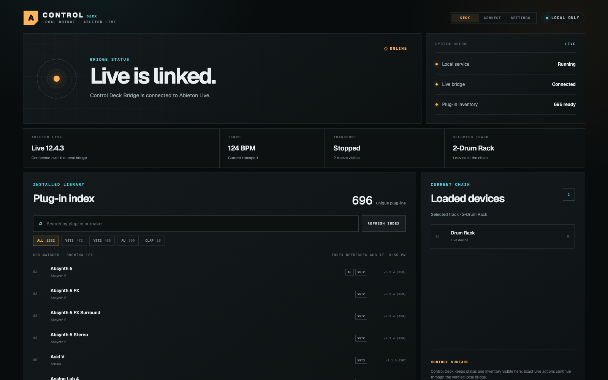

# Ableton Control Deck

Tell an SI what to change in Ableton Live. Control Deck does it on your Mac, then checks Live actually did it.

**Docs, demo & setup guide:** [remymazmanian.com/ableton-control-deck/](https://remymazmanian.com/ableton-control-deck/)



Ableton Control Deck is a local [MCP](https://modelcontextprotocol.io) bridge for Ableton Live. It gives any MCP client — Claude Code, Claude Desktop, Codex, or anything else that speaks MCP — exact, read-back-verified control of Live tracks, clips, transport, devices, and third-party plug-in parameters, plus a local status dashboard.

Everything runs on your machine and binds only to loopback addresses. Nothing is published or exposed to the network.

> Ableton and Ableton Live are trademarks of Ableton AG. This project is an independent community tool and is not affiliated with or endorsed by Ableton.

## How it works

- A Live remote script (`remote-script/Control_Deck/`) runs as a Control Surface inside Ableton Live and listens on UDP port `50711` for an authenticated local request protocol. The Live API it exposes is an explicit allowlist, never a generic method executor.
- The MCP server (`src/index.ts`, compiled to `dist/`) exposes Live control as MCP tools and talks to the remote script through a dependency-free local UDP client (`src/ableton-client.ts`).
- A per-install secret, generated by `npm run setup` and never committed, authenticates every request between the two.
- A read-only status service (`src/dashboard-server.mjs`, port `50712`) and a Next.js dashboard (`dashboard/`, port `50713`) show bridge health, the current Live session, loaded devices, and a searchable local inventory of VST3, VST2, Audio Unit, and CLAP plug-ins.
- An optional Max for Live device, **Control Deck OmniHost** (`max-for-live/`), hosts a VST3 instrument directly and exposes its *complete* published parameter catalog — thousands of parameters, far beyond Live's automatic device panel — over its own loopback channel (UDP `50714`).
- A Hydrasynth helper (`src/hydrasynth/`) turns a description or a JSON patch into NRPN and can request one stored slot as SysEx. It talks to the Hydrasynth Desktop over USB MIDI, outside Live.
- An optional native macOS wrapper (`macos/`) shows the dashboard in a WebKit window locked to the local address; external navigation is blocked.
- An optional local SQLite sample index (`src/sample-index.ts`) makes an external sample drive searchable by keyword, BPM, key, and one-shot/loop kind, without ever writing to the source audio.

## Design rules

- Track and device mutations require both the index and the exact current name; stale names are refused.
- Plug-in loading resolves through Live's own Browser index and refuses ambiguous names instead of guessing.
- Destructive operations (`delete_track`, index rebuilds) require explicit confirmation flags.
- Every mutation is followed by a separate read-back query, and the tool reports the value Live actually shows.
- Completed request IDs are cached by the bridge, so a duplicated UDP request can never run a mutation twice.

## Tools

- Status, transport, tempo, time signature, and song position with readback verification
- List, create, rename, and safely delete tracks
- Create Session View MIDI clips and write validated note content
- Inspect scenes, clips, selection, devices, and every parameter Live exposes
- Discover, resolve, and load VST3/VST2/AU plug-ins on an exact track through Live's Browser
- Load native Live devices (Drum Rack, Echo, Reverb, ...) by exact Browser name with ambiguity refusal
- Read and set third-party plug-in parameters with normalized values and readback
- Control a fully indexed VST3 instrument through OmniHost, past Live's parameter ceiling
- Describe an ASM Hydrasynth Desktop sound and send the key parameters live over USB MIDI as NRPN, or dump one stored slot to a `.syx` file. Phase 1 does not write bank slots.
- Search a local sample index by keyword, folder, BPM, key, duration, and tags
- List, add, rename, and delete Arrangement locators; adding or deleting one needs playback stopped and puts the playhead back afterwards
- `list_arrangement_clips` lists a track's Arrangement clips with start, end, name, and whether each clip is MIDI or audio. You can still tile a Session clip into the Arrangement, and clear a track's Arrangement when you confirm it.
- `create_arrangement_midi_clip` creates an empty MIDI clip in the Arrangement. It works with Live 12.1.10 or newer. You pass the track's index and its current name; if that name does not match, nothing is created, and the new clip is read back.
- `get_arrangement_clip_notes`, `add_arrangement_clip_notes`, `modify_arrangement_clip_notes`, and `remove_arrangement_clip_notes` read, add, change, and remove notes on an Arrangement MIDI clip. The same track-name check applies, and every write is read back from Live.
- `load_user_library_item` loads a saved User Library item, such as an Instrument Rack that holds Pigments or Serum 2, by its exact name onto a track you name exactly. A preset file sitting on disk, such as a `.vstpreset`, is refused.

## Requirements

- **macOS 13 Ventura or newer** (Apple silicon and Intel) — macOS is the only supported platform today. The core is platform-neutral and a Linux/Windows port is well-scoped; see [PORTING.md](PORTING.md).
- Ableton Live 11 or newer (tested target: Live 12)
- Node.js 20+
- Max for Live (optional — only for the OmniHost device)

Full documentation — component descriptions, Live setup, the complete MCP tool reference, troubleshooting, and uninstall — lives in [HELP.md](HELP.md).

## Install

### Quickstart (no coding required)

1. **Install Node.js** — download the LTS version from [nodejs.org](https://nodejs.org) and run its installer with the default options. (Control Deck runs on it; you never have to touch it again.)
2. **Download Control Deck** — use GitHub's green **Code → Download ZIP** button, unzip it, and move the folder somewhere permanent, like your home folder. Don't leave it in Downloads — the installer pins services to the folder's location and will ask you to move it.
3. **Run the installer** — right-click `Install Ableton Control Deck.command` and choose **Open** (macOS requires the right-click the first time for downloaded files). It installs everything, starts the background services, and opens the connection guide when it's done. It's safe to run again at any time.
4. **Enable the Control Surface in Live** — Settings → Link, Tempo & MIDI → pick **Control Deck** in a free Control Surface slot (restart Live first if it was open during setup).
5. **Connect your SI agent** — the guide that opened ([http://127.0.0.1:50713/connect](http://127.0.0.1:50713/connect)) has copy-paste instructions for every client.

### Developer setup

`npm run setup` is the same engine the installer uses — dependency install, TypeScript + OmniHost + dashboard builds, per-install secret, remote-script install, and launchd agents (written *and* activated). It's idempotent; re-run it after pulling changes or moving the checkout.

```sh
npm run setup
```

Flags for a tighter loop: `--skip-build` (no npm installs/builds), `--skip-remote-script`, `--skip-agents`. The granular pieces are still available as individual scripts (`build`, `build:omnihost`, `install:omnihost`, `index:plugins`, `samples:index`, and the dashboard's own `dev`/`build`/`check`).

What setup manages:

1. a per-install secret at `data/bridge-token` (shared by the remote script and clients; never committed),
2. the remote script (secret stamped in) at `~/Music/Ableton/User Library/Remote Scripts/Control_Deck/`,
3. two launchd agents pointing at this checkout: `com.abletondeck.api` and `com.abletondeck.dashboard`.

Then add the MCP server to your client. For example, for Claude Code:

```sh
claude mcp add ableton -- node /path/to/ableton-control-deck/dist/src/index.js
```

In Live, open **Settings → Link, Tempo & MIDI** and confirm **Control Deck** is selected as a Control Surface.

### Connecting other agents

The dashboard's **Connect** page ([http://127.0.0.1:50713/connect](http://127.0.0.1:50713/connect)) has copy-paste setup guides — rendered with your machine's real install path — for Claude Code, Claude Desktop, Codex, Cursor, VS Code, Windsurf, Gemini CLI, Grok CLI, fully local LLM harnesses (LM Studio, Ollama via mcphost), and any other MCP client, plus an honest discussion of what it would take (and cost, security-wise) to expose the bridge to remote connectors like claude.ai. The short version: any agent that can launch a stdio MCP server can drive Live; remote cloud connectors are deliberately out of scope.

## Control Deck dashboard

Open the deck at [http://127.0.0.1:50713](http://127.0.0.1:50713) (it starts at login if you activated the launch agents). It shows bridge health, the current Live session, the selected track's device chain, and a searchable local inventory of installed plug-ins. Its settings page controls bridge connection, refresh behavior, library defaults, density, color, and motion. Project changes continue to use the exact, read-back-verified MCP tools.

The optional native app is built with `npm run build:macos` as `Ableton Control Deck.app`.

## Local commands

```sh
npm run check          # type-check + syntax-check all sources
npm test               # unit tests (client, tools, validation, safety)
npm run test:bridge    # remote-script protocol tests (Python)
npm run index:plugins  # rebuild the local plug-in inventory
npm run samples:index  # refresh the sample index
npm run build:macos    # build the native wrapper app
```

The dashboard has its own build check:

```sh
cd dashboard
npm run check
```

## Hydrasynth Desktop

Phase 1 plays a patch on the ASM Hydrasynth Desktop over USB MIDI, then leaves saving to the front panel. It does not write a bank slot. MatrixBrute is not part of this path.

Back up the Hydrasynth before the first live send. NRPN edits the sound you are hearing. The panel shows a star on an edited patch. Press Save on the instrument if you want to keep it. Nothing in this phase stores that edit into a bank for you.

On the Hydrasynth, open the MIDI page and set **Param TX** and **Param RX** to **NRPN**. CC will not carry this parameter set. The MIDI channel in `config/hydrasynth.json` has to match the instrument. Channel numbers here are 1–16.

Setup copies `config/hydrasynth.example.json` to `config/hydrasynth.json` when that file is missing. Set `portName` to the exact USB MIDI port:

```sh
# from an MCP client, or dry-run the same call
# hydra_list_ports
```

The port name is whatever macOS shows, often a Hydrasynth name from the USB device. Leave `portName` empty until `hydra_list_ports` prints it. Live send needs the optional MIDI library on that Mac, because the repo does not ship a native MIDI binding:

```sh
npm install easymidi
```

Dry-run does not need `easymidi` or the instrument. `CONTROL_DECK_DRY_RUN=1` forces every apply and dump to stay on the dry-run path.

```json
{ "tool": "hydra_apply_patch", "arguments": { "description": "warm soft pad, no pitch drift", "dryRun": true } }
```

That call starts from a documented init baseline (the values decoded from Edisyn's `ASMHydrasynth.init` preset, firmware byte 2.0.0), overlays a small keyword reading of the sentence, and returns the parameter JSON plus the NRPN bytes. "Warm" in that sentence means a darker lowpass and a sine oscillator. It does not switch on Hydrasynth Warm Mode. The phrase "no pitch drift" then forces voice detune, analog feel, vibrato amount, Warm Mode, and all three oscillator cents to zero, after any explicit `parameters` you also pass. Semitone offsets are left alone.

Pass `dryRun: false` to send. The tool pauses 5 ms between NRPN messages. Edisyn's notes say the Hydrasynth drops parameters if a full patch is blasted at it. Every apply also turns BPM sync off for envelope 1, envelope 2, LFO 1, and the delay, so the free-running attack, rate, and delay time are the values the instrument uses. Select **Init** on the panel before the first apply if you want a predictable start: only the mapped parameters are written, so mutant modes, the mod matrix, macros, and the arp stay as they already are. Envelope 2 is the amplifier envelope. Filter 1 follows envelope 1 through its Env 1 amount.

`hydra_list_parameters` returns the 59 ids, ranges, and init values. Values are Edisyn's model units, not MIDI 0–127. A cutoff of 1024 is fully open. Bipolar amounts use 512 as zero. An assistant can pass any of those ids in `parameters` and skip the keyword layer.

`hydra_dump_current` asks the instrument for one stored slot and writes the reply to a `.syx` file under `data/hydrasynth/`. If the handshake stops early, the bytes that arrived are still saved and the call returns an error. `bank` is `A`–`H` (or 0–7) and `program` is the panel number 1–128, so B016 is bank `B`, program 16. The request bytes for A128 match the worked example in Edisyn's SysEx notes (`F0 00 20 2B 00 6F` … `GdtjkQQAAH8=`). There is no documented SysEx request for the edit buffer, on 1.5.5, 2.0.0, or in the 12 Dec 2025 patch-format note. A dump of B016 is the slot as stored, not unsaved NRPN edits. Save on the panel first if the buffer is the thing you want to capture. The handshake sends a footer when it can. Edisyn notes that skipping the footer leaves the panel sluggish for about 20 seconds. The slot-write command is not implemented.

Firmware 2.2.0 is not what those SysEx notes were tested against. `SysexEncoding.txt` (1 May 2023) says the encoding was checked on 1.5.5 and 2.0.0. `SysexPatchFormat.txt` (updated 12 Dec 2025) says the author believes 2.2.0 uses the same patch layout as 2.0.0 and stores version byte `0xDC`. This repo accepts that byte, reports the name and version, and says plainly when the byte is unknown or the marker bytes are not the ones Edisyn recorded. A dump that fails the CRC is kept in the `.syx` file and is not treated as patch data. The front-panel Send Patch stream (`F0 01 …`) is a different encoding and is not decoded. Do not treat a successful 2.2.0 decode in these tests as a hardware confirmation. The tests build the bytes offline.

NRPN numbers come from Sean Luke's corrected table in Edisyn (`ASMHydrasynth.java` and `info/nrpn.csv`), which exists because ASM's published NRPN PDF is wrong in places. The source links are in `src/hydrasynth/parameters.ts` and in `hydra_list_parameters`.

## Security model

- The bridge listens on `127.0.0.1` UDP `50711` only; the status service, dashboard, and OmniHost all bind to loopback only.
- Every bridge request must carry the per-install secret from `data/bridge-token`. The remote script refuses to start if the secret was never stamped.
- The Live API surface is an explicit allowlist with exact-target safeguards, so a confused agent fails loudly instead of editing the wrong thing.
- The MCP server logs requests locally to `logs/control-deck.jsonl` so you can audit what an agent did.

## License

[MIT](LICENSE)
