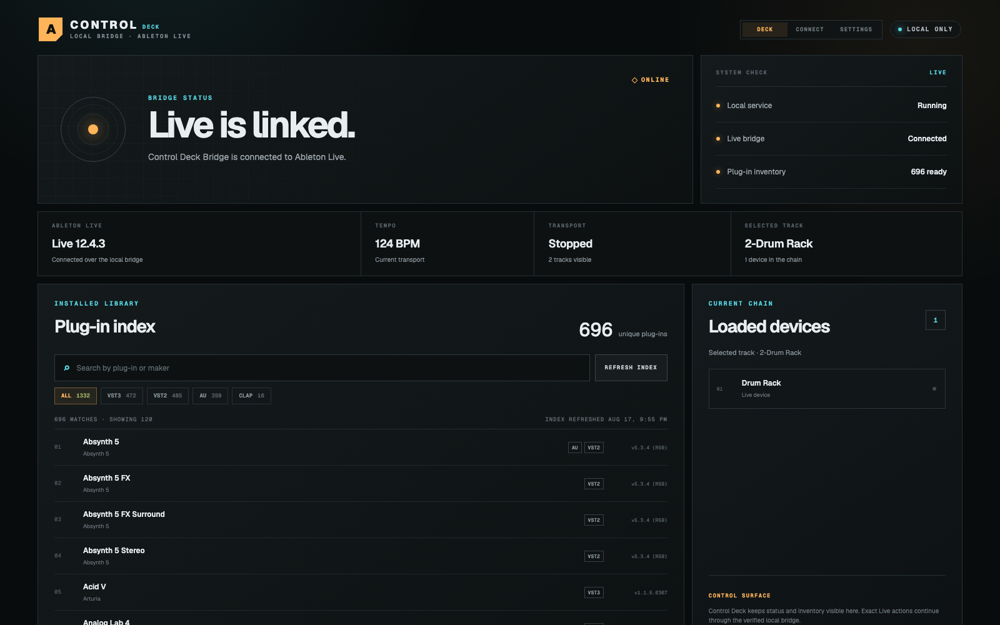

# Ableton Control Deck

Tell an AI what to change in Ableton Live. Control Deck does it on your Mac, then checks Live actually did it.

**Docs, demo & setup guide:** [remymazmanian.com/ableton-control-deck/](https://remymazmanian.com/ableton-control-deck/)



Ableton Control Deck is a local [MCP](https://modelcontextprotocol.io) bridge for Ableton Live. It gives any MCP client — Claude Code, Claude Desktop, Codex, or anything else that speaks MCP — exact, read-back-verified control of Live tracks, clips, transport, devices, and third-party plug-in parameters, plus a local status dashboard.

Everything runs on your machine and binds only to loopback addresses. Nothing is published or exposed to the network.

> Ableton and Ableton Live are trademarks of Ableton AG. This project is an independent community tool and is not affiliated with or endorsed by Ableton.

## How it works

- A Live remote script (`remote-script/Control_Deck/`) runs as a Control Surface inside Ableton Live and listens on UDP port `50711` for an authenticated local request protocol. The Live API it exposes is an explicit allowlist, never a generic method executor.
- The MCP server (`src/index.ts`, compiled to `dist/`) exposes Live control as MCP tools and talks to the remote script through a dependency-free local UDP client (`src/ableton-client.ts`).
- A per-install secret, generated by `npm run setup` and never committed, authenticates every request between the two.
- A read-only status service (`src/dashboard-server.mjs`, port `50712`) and a Next.js dashboard (`dashboard/`, port `50713`) show bridge health, the current Live session, loaded devices, and a searchable local inventory of VST3, VST2, Audio Unit, and CLAP plug-ins.
- An optional Max for Live device, **Control Deck OmniHost** (`max-for-live/`), hosts a VST3 instrument directly and exposes its *complete* published parameter catalog — thousands of parameters, far beyond Live's automatic device panel — over its own loopback channel (UDP `50714`).
- An optional native macOS wrapper (`macos/`) shows the dashboard in a WebKit window locked to the local address; external navigation is blocked.
- An optional local SQLite sample index (`src/sample-index.ts`) makes an external sample drive searchable by keyword, BPM, key, and one-shot/loop kind, without ever writing to the source audio.

## Design rules

- Track and device mutations require both the index and the exact current name; stale names are refused.
- Plug-in loading resolves through Live's own Browser index and refuses ambiguous names instead of guessing.
- Destructive operations (`delete_track`, index rebuilds) require explicit confirmation flags.
- Every mutation is followed by a separate read-back query, and the tool reports the value Live actually shows.
- Completed request IDs are cached by the bridge, so a duplicated UDP request can never run a mutation twice.

## Tools

- Status, transport, tempo, time signature, and song position with readback verification
- List, create, rename, and safely delete tracks
- Create Session View MIDI clips and write validated note content
- Inspect scenes, clips, selection, devices, and every parameter Live exposes
- Discover, resolve, and load VST3/VST2/AU plug-ins on an exact track through Live's Browser
- Load native Live devices (Drum Rack, Echo, Reverb, ...) by exact Browser name with ambiguity refusal
- Read and set third-party plug-in parameters with normalized values and readback
- Control a fully indexed VST3 instrument through OmniHost, past Live's parameter ceiling
- Search a local sample index by keyword, folder, BPM, key, duration, and tags
- List, add, rename, and delete Arrangement locators; adding or deleting one needs playback stopped and puts the playhead back afterwards
- List a track's Arrangement clips with start, end, name, and MIDI or audio type; tile a Session clip into the Arrangement over a beat range; and clear a track's Arrangement (confirmation required)
- Create an empty Arrangement MIDI clip on Live 12.1.10 or newer, then read, add, change, or remove its notes. Every write is read back.
- Load a User Library item, such as a saved Instrument Rack holding Pigments or Serum 2, by exact name. A preset file path on disk is refused.

## Requirements

- **macOS 13 Ventura or newer** (Apple silicon and Intel) — macOS is the only supported platform today. The core is platform-neutral and a Linux/Windows port is well-scoped; see [PORTING.md](PORTING.md).
- Ableton Live 11 or newer (tested target: Live 12)
- Node.js 20+
- Max for Live (optional — only for the OmniHost device)

Full documentation — component descriptions, Live setup, the complete MCP tool reference, troubleshooting, and uninstall — lives in [HELP.md](HELP.md).

## Install

### Quickstart (no coding required)

1. **Install Node.js** — download the LTS version from [nodejs.org](https://nodejs.org) and run its installer with the default options. (Control Deck runs on it; you never have to touch it again.)
2. **Download Control Deck** — use GitHub's green **Code → Download ZIP** button, unzip it, and move the folder somewhere permanent, like your home folder. Don't leave it in Downloads — the installer pins services to the folder's location and will ask you to move it.
3. **Run the installer** — right-click `Install Ableton Control Deck.command` and choose **Open** (macOS requires the right-click the first time for downloaded files). It installs everything, starts the background services, and opens the connection guide when it's done. It's safe to run again at any time.
4. **Enable the Control Surface in Live** — Settings → Link, Tempo & MIDI → pick **Control Deck** in a free Control Surface slot (restart Live first if it was open during setup).
5. **Connect your AI agent** — the guide that opened ([http://127.0.0.1:50713/connect](http://127.0.0.1:50713/connect)) has copy-paste instructions for every client.

### Developer setup

`npm run setup` is the same engine the installer uses — dependency install, TypeScript + OmniHost + dashboard builds, per-install secret, remote-script install, and launchd agents (written *and* activated). It's idempotent; re-run it after pulling changes or moving the checkout.

```sh
npm run setup
```

Flags for a tighter loop: `--skip-build` (no npm installs/builds), `--skip-remote-script`, `--skip-agents`. The granular pieces are still available as individual scripts (`build`, `build:omnihost`, `install:omnihost`, `index:plugins`, `samples:index`, and the dashboard's own `dev`/`build`/`check`).

What setup manages:

1. a per-install secret at `data/bridge-token` (shared by the remote script and clients; never committed),
2. the remote script (secret stamped in) at `~/Music/Ableton/User Library/Remote Scripts/Control_Deck/`,
3. two launchd agents pointing at this checkout: `com.abletondeck.api` and `com.abletondeck.dashboard`.

Then add the MCP server to your client. For example, for Claude Code:

```sh
claude mcp add ableton -- node /path/to/ableton-control-deck/dist/src/index.js
```

In Live, open **Settings → Link, Tempo & MIDI** and confirm **Control Deck** is selected as a Control Surface.

### Connecting other agents

The dashboard's **Connect** page ([http://127.0.0.1:50713/connect](http://127.0.0.1:50713/connect)) has copy-paste setup guides — rendered with your machine's real install path — for Claude Code, Claude Desktop, Codex, Cursor, VS Code, Windsurf, Gemini CLI, Grok CLI, fully local LLM harnesses (LM Studio, Ollama via mcphost), and any other MCP client, plus an honest discussion of what it would take (and cost, security-wise) to expose the bridge to remote connectors like claude.ai. The short version: any agent that can launch a stdio MCP server can drive Live; remote cloud connectors are deliberately out of scope.

## Control Deck dashboard

Open the deck at [http://127.0.0.1:50713](http://127.0.0.1:50713) (it starts at login if you activated the launch agents). It shows bridge health, the current Live session, the selected track's device chain, and a searchable local inventory of installed plug-ins. Its settings page controls bridge connection, refresh behavior, library defaults, density, color, and motion. Project changes continue to use the exact, read-back-verified MCP tools.

The optional native app is built with `npm run build:macos` as `Ableton Control Deck.app`.

## Local commands

```sh
npm run check          # type-check + syntax-check all sources
npm test               # unit tests (client, tools, validation, safety)
npm run test:bridge    # remote-script protocol tests (Python)
npm run index:plugins  # rebuild the local plug-in inventory
npm run samples:index  # refresh the sample index
npm run build:macos    # build the native wrapper app
```

The dashboard has its own build check:

```sh
cd dashboard
npm run check
```

## Security model

- The bridge listens on `127.0.0.1` UDP `50711` only; the status service, dashboard, and OmniHost all bind to loopback only.
- Every bridge request must carry the per-install secret from `data/bridge-token`. The remote script refuses to start if the secret was never stamped.
- The Live API surface is an explicit allowlist with exact-target safeguards, so a confused agent fails loudly instead of editing the wrong thing.
- The MCP server logs requests locally to `logs/control-deck.jsonl` so you can audit what an agent did.

## License

[MIT](LICENSE)
